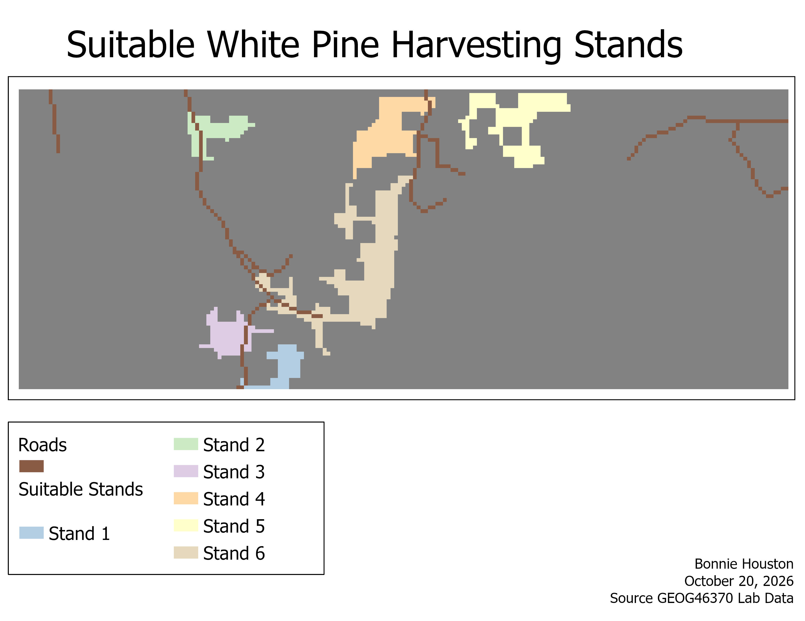

# GIS-Based White Pine Harvesting Suitability Analysis

**Tools:** ArcGIS Pro | Raster Reclassification | Euclidean Distance | Raster Overlay | Region Group | Zonal Geometry

## Project Overview

In this forest management project, I used raster datasets to identify areas that could be considered for harvesting leases for a small timber company.

The analysis used three criteria:

1. Do not cut trees within **1,000 meters** of any water body or stream.
2. Only **White Pine** is to be harvested.
3. Leases must cover at least **1,000 hectares**.

## Methods

I selected water areas from the shoreline raster and calculated distance from water. I kept areas outside the 1,000-meter distance, selected the White Pine areas from the forest species raster, and overlaid the two results to produce suitable cells.

I then grouped contiguous cells into stands, calculated stand area, converted square meters into hectares, and kept the stands meeting the 1,000-hectare minimum. Finally, I added roads to the map as a visual reference and to show how accessible the stands would be for transporting timber and equipment.

### Final Suitability Map

## Results

The largest qualifying stand was **Stand 6**, with an area of **6,088.250 hectares**.

The final map shows separate suitable stands and the roads in the study area.

## Additional Considerations

If the project also excluded areas with potential for upland wildlife, organized camping, or viewing areas, I would reclassify the recreation subclass layer to create a mask, multiply the mask by the suitable White Pine areas, and repeat region grouping, area calculation, and the 1,000-hectare selection.

The map identifies stands meeting the three stated raster criteria. Roads were added for visual reference; accessibility was not included as a numerical selection criterion.

**Data:** MAPLE course raster dataset.

*Course project: GEOG 4370, Introduction to GIScience.*
